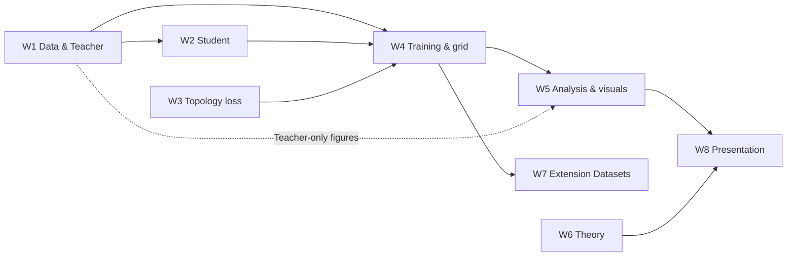

# Project plan

The skeleton the team works from: what we are trying to show, what we run, how the work splits into workstreams people can pick up, and the rules that keep five people from blocking each other. Implementation choices belong to each workstream's owner and are listed below as **open questions**, not decided here.

Vocabulary: [`CONTEXT.md`](../CONTEXT.md). Contracts between workstreams: [`interfaces.md`](interfaces.md). Decisions: [`adr/`](adr/).

## Course constraints (from the brief and the GI project guide)

- Explore one application of geometry/topology to data analysis or AI models; topology is explicitly in scope.
- Memoria due **Fri 27/11**; presentations **1/12 – 4/12**: **7 minutes** covering the mathematical foundations, the technique, the experimental results and the conclusions, followed by the professor's questions.
- Generative AI may be used for exploration and code prototypes, **not for writing the memoria**.

## Research question

> On the Core Dataset (MNIST), does adding the Topology Distillation Loss make the Student's latent space take on the Teacher's shape, and does that help accuracy beyond plain KD?

**Interpretable** means we can check the topology by eye: at the last Layer Pair, a good network's Latent Point Cloud should show one Class Cluster per digit, which appears as long-lived H0 bars in its Persistence Diagram. So we can see whether a PD is good or bad, and whether a Student's PD resembles the Teacher's.

Two kinds of results:

1. **Accuracy** of each Student, compared across Conditions, with the Teacher as the ceiling.
2. **Shape**: Persistence Diagrams, Persistence Images and 2-D/3-D projections of Teacher vs Student Latent Point Clouds.

## Approach

TopKD adapted to a small task (see [ADR 0001](adr/0001-exact-pi-at-several-layer-pairs.md)):

- Exact PIs computed with the TDA libraries taught in the course; no RipsNet.
- Topology Distillation Loss applied at several Layer Pairs, e.g. a ~25-layer Teacher and a ~5-layer Student with Teacher layer 5k ↔ Student layer k (depths are the Models subteam's call).
- The upstream code ([jekim5418/TopKD](https://github.com/jekim5418/TopKD)) is a reference: read it, cite it; copying snippets is allowed with an attribution comment (`# Adapted from jekim5418/TopKD, <file>`).

## Experiment grid

Per dataset and per seed:

| Condition | Label-supervised | Label-free |
|---|---|---|
| **Baseline** (no Teacher) | scratch, pretrained | — (no training signal) |
| **KD** | scratch, pretrained | scratch, pretrained |
| **Top** | scratch, pretrained | scratch, pretrained — evaluated with a Probe Head |
| **KD+Top** (the paper's TopKD) | scratch, pretrained | scratch, pretrained |

= **14 runs** per dataset per seed. *Pretrained* means the Student starts from weights found online; *scratch* means random initialisation.

Expected highlight: **Top × Label-free**. The Topology Distillation Loss cannot tell the Student which cluster is which digit (a PD is unchanged if clusters swap), so the Student should learn the right *shape* with no class assignment; the Probe Head then measures whether that shape plus a trained classification head is enough.

Datasets:

- **Core Dataset** — MNIST: full grid; used in the presentation.
- **Extension Datasets** — Fashion-MNIST and other similar datasets: extra runs for the memoria only.

## Workstreams

Each workstream has one clear output. "Needs" lists only what it must wait for; anything can start against the stubs in `tests/contracts/`.

### W1 — Data & Teacher
- **Output:** dataset loaders (Core + Extension) and a Teacher checkpoint that satisfies the Model interface.
- **Needs:** nothing.
- **Open questions:** Teacher architecture and depth (~25 layers in the initial idea); download a pretrained Teacher or train it ourselves; whether the From-scratch/Pretrained axis also applies to the Teacher; DagsHub or HF for storing the checkpoint.

### W2 — Student
- **Output:** Student definition(s) satisfying the Model interface, and pretrained Student weights.
- **Needs:** W1 (Teacher depth, to fix the Layer Pairs).
- **Open questions:** architecture and depth (~5 layers); Layer Pair mapping; where to find pretrained weights online (they fix the architecture); handling different latent dimensions between Teacher and Student.

### W3 — Topology Distillation Loss
- **Output:** `topology_loss(teacher_cloud, student_cloud)` satisfying the Loss interface.
- **Needs:** nothing (prototype on random clouds). Highest-risk workstream — start first.
- **Open questions:** **how gradients reach the Student through an Exact PI** (library PIs are not differentiable by themselves); which library (gudhi, ripser/persim, giotto-tda); homology dimensions (H0 only, as the paper's default, or also H1); PI settings (resolution, σ, weight function); scale normalisation of the clouds; batch size vs cost per step.

### W4 — Training & experiment grid
- **Output:** the results table and the saved Students (Results interface).
- **Needs:** W1, W2, W3.
- **Open questions:** loss weights and KD temperature; epochs; number of seeds; Probe Head design; whether and how to use the DGX (e.g. the git-fed job runner already used in another project); logging.

### W5 — Analysis & visuals
- **Output:** figures and tables for the memoria and the slides.
- **Needs:** W4 (can start on the Teacher alone as soon as W1 lands).
- **Open questions:** which `topology_distance` to report (with W3: bottleneck, Wasserstein, PI distance…); projection method (UMAP or other); which few figures carry the 7-minute story.

### W6 — Theory
- **Output:** the memoria's background sections.
- **Needs:** nothing.
- **Open questions:** how deep to go into Rips filtrations, persistent homology, PDs/PIs and KD as KL divergence; how to tie it to the course (GI Tema 1).

### W7 — Extension Datasets
- **Output:** Extension Dataset results for the memoria.
- **Needs:** W4.
- **Open questions:** which datasets besides Fashion-MNIST; a reduced grid or the full one.

### W8 — Presentation
- **Output:** 7-minute slides and preparation for the professor's questions.
- **Needs:** W5, W6.
- **Open questions:** slide format (LaTeX or other — to be decided by the team).

### Dependencies

Critical path: **W1/W2 + W3 → W4 → W5**. There are no internal dates; the interfaces and stubs exist so that nobody has to wait for an upstream workstream to start.

## Subteams

| Subteam | Workstreams | Folder(s) | People |
|---|---|---|---|
| **Models** | W1, W2 | `src/topkd_imat/data/`, `src/topkd_imat/models/` | 1–2 |
| **Topology** | W3 | `src/topkd_imat/topology/` | 1 |
| **Experiments** | W4, W7 | `src/topkd_imat/training/` | 1 |
| **Story** | W5, W6, W8 | `src/topkd_imat/analysis/`, `report/`, `slides/` | 1–2 |

## Memoria

- **Language:** Spanish (unless the team changes it). Use the `_Español_` wording from `CONTEXT.md`.
- **Format:** to be decided by the team (LaTeX in this repo — compiles with tectonic or Overleaf — or Word). Same for the slides.
- **Each owner writes the section about their own work** — no single writer:

| Section | Written by |
|---|---|
| Introduction; background (TDA, PD/PI, KD as KL, the TopKD paper) | W6 |
| Method: our adaptation (Exact PI loss, Layer Pairs) | W3 + W2 |
| Experimental setup (data, Teacher, Student, Conditions) | W1 + W2 + W4 |
| Results — Core Dataset | W4 + W5 |
| Results — Extension Datasets | W7 |
| Conclusions | everyone, short |

- A final consistency pass (terms, notation, figure style) before submission — editing, not rewriting.

## Team rules

1. **`main` always runs** — meaning `make test` passes. Never commit on `main`; work on a branch and merge into `main` only when `make test` passes on the merged result.
2. **Push with `make push`**: it runs the tests first. A GitHub Action also runs the tests on every push to every branch, and flags a broken `main` within minutes.
3. **Each subteam owns its folder** and touches other folders only through the three interfaces in [`interfaces.md`](interfaces.md). `analysis/` never imports `training/`; it reads result files.
4. **The consumer tests the provider.** For each interface, the subteam that uses it writes the contract tests and a stub in `tests/contracts/`; the provider is done when those tests pass against the real implementation.
5. **Changing an interface or a glossary term** needs agreement from every subteam it affects.
6. **No large files in git** — datasets, checkpoints and Latent Point Clouds go to DagsHub or HF (choice open). Small results (the results CSV, figures) are fine.
7. **Notebooks are for exploration and figures only**; nothing imports from a notebook.
8. `make lint` keeps code tidy; it is recommended, not required for pushing.
