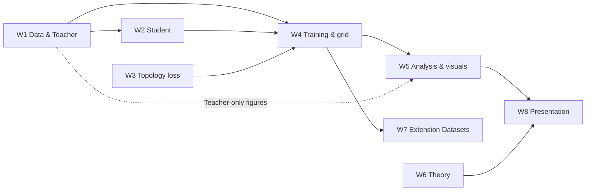

# Project plan

The skeleton the team works from: what we are trying to show, what we run, how the work splits into workstreams people can pick up, and the rules that keep five people from blocking each other. Implementation choices belong to each workstream's owner and are listed below as **open questions**, not decided here.

Vocabulary: [`CONTEXT.md`](../CONTEXT.md). Contracts between workstreams: [`interfaces.md`](interfaces.md). Decisions: [`adr/`](adr/).

## Course constraints (from the brief and the GI project guide)

- Explore one application of geometry/topology to data analysis or AI models; topology is explicitly in scope.
- Memoria due **Fri 27/11**; presentations **1/12 – 4/12**: **7 minutes** covering the mathematical foundations, the technique, the experimental results and the conclusions, followed by the professor's questions.
- Generative AI may be used for exploration and code prototypes, **not for writing the memoria**.

## Research question

> On the Core Dataset (CIFAR-10), does adding the Topology Distillation Loss make the Student's latent space take on the Teacher's shape, and does that help accuracy beyond plain KD?

**Interpretable** means we can check the topology by eye: at the last Layer Pair, a good network's Latent Point Cloud should show one Class Cluster per class (10 classes), which appears as long-lived H0 bars in its Persistence Diagram. So we can see whether a PD is good or bad, and whether a Student's PD resembles the Teacher's.

Two kinds of results:

1. **Accuracy** of each Student, compared across Conditions, with the Teacher as the ceiling.
2. **Shape**: Persistence Diagrams, Persistence Images and 2-D/3-D projections of Teacher vs Student Latent Point Clouds.

## Approach

TopKD adapted to a small task (see [ADR 0001](adr/0001-exact-pi-at-several-layer-pairs.md)):

- Exact PIs computed with the TDA libraries taught in the course; no RipsNet.
- Topology Distillation Loss applied at several Layer Pairs, e.g. a ~25-layer Teacher and a ~5-layer Student with Teacher layer 5k ↔ Student layer k (depths are the Models subteam's call).
- The upstream code ([jekim5418/TopKD](https://github.com/jekim5418/TopKD)) is a reference: read it, cite it; copying snippets is allowed with an attribution comment (`# Adapted from jekim5418/TopKD, <file>`).

## Experiment grid

Per dataset and per seed:

| Condition | Label-supervised | Label-free |
|---|---|---|
| **Baseline** (no Teacher) | scratch, pretrained | — (no training signal) |
| **KD** | scratch, pretrained | scratch, pretrained |
| **Top** | scratch, pretrained | scratch, pretrained — evaluated with a Probe Head |
| **KD+Top** (the paper's TopKD) | scratch, pretrained | scratch, pretrained |

= **14 runs** per dataset per seed. *Pretrained* means the Student starts from weights found online; *scratch* means random initialisation.

Expected highlight: **Top × Label-free**. The Topology Distillation Loss cannot tell the Student which cluster is which class (a PD is unchanged if clusters swap), so the Student should learn the right *shape* with no class assignment; the Probe Head then measures whether that shape plus a trained classification head is enough.

Datasets:

- **Core Dataset** — CIFAR-10: full grid; used in the presentation. Chosen over MNIST at the 2026-11-21 meeting ([ADR 0002](adr/0002-cifar10-core-dataset.md)).
- **Extension Datasets** — extra runs for the memoria only; which ones is W7's call (see W7).

## Workstreams

Each workstream has one clear output. "Needs" lists only what it must wait for; anything can start against the stubs in `tests/contracts/`.

### W1 — Data & Teacher
- **Owner:** Mario
- **Output:** dataset loaders (Core + Extension) and a Teacher checkpoint that satisfies the Model interface.
- **Needs:** nothing.
- **Open questions:** Teacher architecture and depth (~25 layers in the initial idea); download a pretrained Teacher or train it ourselves; whether the From-scratch/Pretrained axis also applies to the Teacher; DagsHub or HF for storing the checkpoint.
- **Decided** ([ADR 0003](adr/0003-resnet56-teacher-pruned-resnet8-student.md), accepted 2026-11-22): downloaded CIFAR-10 ResNet-56 (94.37 %), not trained by us; pretrained only (no scratch Teacher); no checkpoint storage needed: `build_teacher()` / `build_student()` rebuild both models identically on any machine and training calls them when no checkpoint path is given. Dataset loaders: `training/data.py` is the definitive loader (team, 2026-11-22).

### W2 — Student
- **Owner:** Mario
- **Output:** Student definition(s) satisfying the Model interface, and pretrained Student weights.
- **Needs:** W1 (Teacher depth, to fix the Layer Pairs).
- **Open questions:** architecture and depth (~5 layers); Layer Pair mapping; where to find pretrained weights online (they fix the architecture); handling different latent dimensions between Teacher and Student.
- **Decided** ([ADR 0003](adr/0003-resnet56-teacher-pruned-resnet8-student.md), accepted 2026-11-22): ResNet-8 depth-pruned from the CIFAR-100 ResNet-20 and retrained on CIFAR-100 (weights on the HF Hub, `MarioAlonso7/topkd`); three Layer Pairs, stage *k* ↔ stage *k*, dims 16/32/64 in both networks (no projection needed).

### W3 — Topology Distillation Loss
- **Owners:** Marcos, Mario
- **Output:** `topology_loss(teacher_cloud, student_cloud)` satisfying the Loss interface.
- **Needs:** nothing (prototype on random clouds). Highest-risk workstream — start first.
- **Open questions:** **how gradients reach the Student through an Exact PI** (library PIs are not differentiable by themselves); which library (gudhi, ripser/persim, giotto-tda); homology dimensions (H0 only, as the paper's default, or also H1); PI settings (resolution, σ, weight function); scale normalisation of the clouds; batch size vs cost per step.
- **Decided** ([ADR 0004](adr/0004-h0-persistence-image-loss.md), 2026-11-22; code in `src/topkd_imat/topology/`): H0 only; MST on detached distances, deaths read back as `D[i, j]` so gradients reach the Student; each cloud divided by its mean pairwise distance; loss = MSE between 1-D Persistence Images (100 bins over [0, 2], σ = 2 bins, weight w(p) = p). `topology_distance` = Wasserstein-2 between H0 diagrams of the last Layer Pair over fixed test batches. Cost ~4.5–6 ms per batch on GPU for the three Layer Pairs.
- **Proposed** ([ADR 0005](adr/0005-h0-matched-loss.md), 2026-11-24): `h0-matched`, an H0 loss with correspondence (the Student keeps the distances of the Teacher's MST edges and vice versa, after Moor et al. 2020), because the PI loss cannot tell which image is which. Selected with `run --top-loss h0-matched`; needs its own `w_top` (start at 1).
- **Run options since 2026-11-24** ([ADR 0006](adr/0006-paper-pi.md)): `--top-loss h0-pi-norm` (default; ADR 0004's normalised PI on `[0, 2]`, 200 bins, with σ and max calibrated on the Teacher per Layer Pair) or `h0-matched`. The paper's raw distances were tried and dropped: a scratch Student gets almost no gradient. Every Top run needs a `--runs-dir` of its own loss.

### W4 — Training & experiment grid
- **Owner:** Escobar
- **Output:** the results table and the saved Students (Results interface).
- **Needs:** W1, W2, W3.
- **Decided (2026-11-22; code in `src/topkd_imat/training/`):**
  - *Grid:* per Initialisation, label-supervised × 4 Conditions and label-free × {KD, Top, KD+Top} = 7 runs. Large pretrained Student → `pretrained` only; small one → `pretrained` and `scratch` (scratch = the same Student with `reset_parameters()`). Baseline and KD run without W3 (`grid --skip-top`).
  - *Loss:* CE (label-supervised) + KD as in the TopKD code (T = 4, × T², weight 1) + `w_top` × the mean over Layer Pairs of `topology_loss`. The Teacher is frozen.
  - *Optimiser:* SGD, momentum 0.9, weight decay 5e-4, batch 64; lr 0.1 from scratch and 0.01 to finetune, ÷10 at 62.5/75/87.5 % of the epochs; validation on a fixed 5k slice of the training set.
  - *Seeds:* two (0, 1) in the final grid; a third did not fit in the GPU session.
  - *Probe Head:* only for Top × label-free (KD trains the head otherwise). It is linear, fitted with L-BFGS on frozen last-Layer-Pair features.
  - *Logging:* `metrics.csv` and TensorBoard per run. No job runner on the DGX; runs are started by hand, and the grid resumes where it stopped.
  - *Data:* `training/data.py` is the definitive loader (agreed 2026-11-22; no separate `topkd_imat.data`). Batches are random, of 64. ADR 0004's class-balanced batches of 80 were not adopted (balancing by the labels would leak them into label-free; balancing by the Teacher's predictions was parked by the team).
  - *Models:* built with `topkd_imat.models.build_teacher()` / `build_student()` unless a checkpoint path is given; each run's `config.json` records which (`teacher_source`, `student_source`).
  - *`topology_distance`:* NaN during training, filled afterwards from the saved clouds (`training.fill_distance`).
- **Decided (2026-11-24):**
  - *`w_top` = 0.1.* Swept 0.01 / 0.1 / 1.0 on label-supervised, pretrained, 30 epochs (Top and KD+Top). Criterion: the largest `w_top` whose KD+Top validation accuracy is not below KD's. 1.0 failed it; 0.1 met it.
  - *Epochs = 60, for every Condition.* Baseline scratch, Baseline pretrained and KD pretrained (label-supervised) were rerun at 60 epochs; mean validation gain over 30 epochs was +1.13 points, above the 0.5-point threshold set beforehand.
  - *Final grid:* 14 runs × seeds 0, 1 = 28 runs, `w_top` 0.1, 60 epochs. `results.csv` plus each run's `metrics.csv` and `config.json` are in `results/w4_grid/`; the saved clouds and Students stay on the DGX (`runs_final/`), too large for git.
  - *Sweeps:* the `results.csv` key does not include `w_top` or the epochs, so each setting gets its own `--runs-dir`.
- **Planned (2026-11-24): `w_kd` × `w_top` search for the scratch Student, `h0-pi-norm` only** (`training.search`). The `w_top` = 0.1 above was tuned for ADR 0004's loss on the pretrained Student; `h0-pi-norm` has another scale. Search on KD+Top × label-supervised × scratch: `w_top` 3 / 10 / 30 / 100 (the topology term at about 2 %, 7 %, 20 % and 70 % of KD at the first batch; the W4 sweep kept a term at about 5 % of KD and rejected about 50 %, which are about 6 and 60 in `h0-pi-norm` units) × `w_kd` 1 / 2 / 4 (around the paper's best, 2), plus a KD control at each `w_kd` so KD gets the same tuning; 60 epochs, seed 0, one `--runs-dir` per setting under `runs_search/`. Not searched, kept for every Condition: KD temperature 4 (the paper's), batch 64 (the paper's, and the size of the Latent Point Cloud, so it changes the topology too) and lr 0.1 (the grid's scratch recipe; tuning it only for KD+Top would favour it). Criterion: the highest last-epoch **validation** accuracy, separately for KD (over `w_kd`) and KD+Top (over `w_kd` × `w_top`) — not the W4 sweep's "largest `w_top` not below KD", and never test (`runs_search/summary.csv`). Then rerun the best setting and its neighbours on seeds 1–2 before fixing it. Top × label-free is not in the search: its head is untrained, so selecting for it needs a Probe Head on the validation split first. On the DGX:
  ```bash
  uv run python -m topkd_imat.training.search --root runs_search --epochs 60 --seeds 0
  ```
  15 runs, ≈15 min each on the GPU (≈1.7 h each on a CPU). Re-running resumes; `--summary-only` rebuilds the table, `--dry-run` lists the runs.
- **Open questions:** none for the grid. Possible control, not run: the Probe Head on the untrained Student (scratch and pretrained), to compare with Top × label-free.
- **DGX facts (onboarding test, 2026-11-18):** the repo installs and passes `make test` on the DGX (NVIDIA H200 MIG slice, driver 580.196.07, uv 0.12, GNU Make 4.3); the locked torch 2.15 / CUDA 13 build sees the GPU (`torch.cuda.is_available()` → `True NVIDIA H200 MIG 1g.18gb`), so no CUDA 12 pin is needed. The slice (~16 GB) is **shared with another project's job runner** and runs one GPU job at a time, so TopKD training there needs scheduling around it. Unset `UV_PROJECT_ENVIRONMENT` before `make install` if your shell exports it.

### W5 — Analysis & visuals
- **Owners:** Ahumada, Pedro
- **Output:** figures and tables for the memoria and the slides.
- **Needs:** W4 (can start on the Teacher alone as soon as W1 lands).
- **Open questions:** which `topology_distance` to report (with W3: bottleneck, Wasserstein, PI distance…); projection method (UMAP or other); which few figures carry the 7-minute story.

### W6 — Theory
- **Owner:** Ahumada
- **Output:** the memoria's background sections.
- **Needs:** nothing.
- **Open questions:** how deep to go into Rips filtrations, persistent homology, PDs/PIs and KD as KL divergence; how to tie it to the course (GI Tema 1).

### W7 — Extension Datasets
- **Owner:** *unassigned* (not given out at the 2026-11-21 meeting; optional — memoria only)
- **Output:** Extension Dataset results for the memoria.
- **Needs:** W4.
- **Open questions:** which datasets (e.g. MNIST / Fashion-MNIST as an easier sanity check, CIFAR-100 as the paper's setting); a reduced grid or the full one.

### W8 — Presentation
- **Owner:** Pedro
- **Output:** 7-minute slides and preparation for the professor's questions.
- **Needs:** W5, W6.
- **Open questions:** slide format (LaTeX or other — to be decided by the team).

### Dependencies



Critical path: **W1/W2 + W3 → W4 → W5**. Mario is on W1, W2 and W3, so every input to W4 runs through one person; W3 is shared with Marcos to spread that load. There are no internal dates; the interfaces and stubs exist so that nobody has to wait for an upstream workstream to start.

## Subteams

| Subteam | Workstreams | Folder(s) | People |
|---|---|---|---|
| **Models** | W1, W2 | `src/topkd_imat/data/`, `src/topkd_imat/models/` | Mario |
| **Topology** | W3 | `src/topkd_imat/topology/` | Marcos, Mario |
| **Experiments** | W4, W7 | `src/topkd_imat/training/` | Escobar (W7 unassigned) |
| **Story** | W5, W6, W8 | `src/topkd_imat/analysis/`, `report/`, `slides/` | Ahumada, Pedro |

Assigned at the team meeting of 2026-11-21:

| Person | Workstreams |
|---|---|
| Marcos | W3 Topology loss |
| Ahumada | W5 Analysis & visuals · W6 Theory |
| Mario | W1 Data & Teacher · W2 Student · W3 Topology loss |
| Pedro | W5 Analysis & visuals · W8 Presentation |
| Escobar | W4 Training & grid |

## Memoria

- **Language:** Spanish (unless the team changes it). Use the `_Español_` wording from `CONTEXT.md`.
- **Format:** to be decided by the team (LaTeX in this repo — compiles with tectonic or Overleaf — or Word). Same for the slides.
- **Each owner writes the section about their own work** — no single writer:

| Section | Written by |
|---|---|
| Introduction; background (TDA, PD/PI, KD as KL, the TopKD paper) | W6 |
| Method: our adaptation (Exact PI loss, Layer Pairs) | W3 + W2 |
| Experimental setup (data, Teacher, Student, Conditions) | W1 + W2 + W4 |
| Results — Core Dataset | W4 + W5 |
| Results — Extension Datasets | W7 |
| Conclusions | everyone, short |

- A final consistency pass (terms, notation, figure style) before submission — editing, not rewriting.

## Team rules

1. **`main` always runs** — meaning `make test` passes. Never commit on `main`; work on a branch and merge into `main` only when `make test` passes on the merged result.
2. **Push with `make push`**: it runs the tests first. A GitHub Action also runs the tests on every push to every branch, and flags a broken `main` within minutes.
3. **Each subteam owns its folder** and touches other folders only through the three interfaces in [`interfaces.md`](interfaces.md). `analysis/` never imports `training/`; it reads result files.
4. **The consumer tests the provider.** For each interface, the subteam that uses it writes the contract tests and a stub in `tests/contracts/`; the provider is done when those tests pass against the real implementation.
5. **Changing an interface or a glossary term** needs agreement from every subteam it affects.
6. **No large files in git** — datasets, checkpoints and Latent Point Clouds go to DagsHub or HF (choice open). Small results (the results CSV, figures) are fine.
7. **Notebooks are for exploration and figures only**; nothing imports from a notebook.
8. `make lint` keeps code tidy; it is recommended, not required for pushing.
